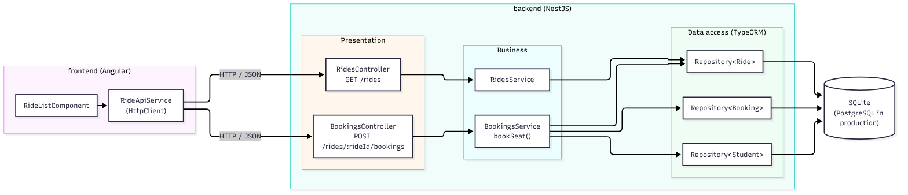
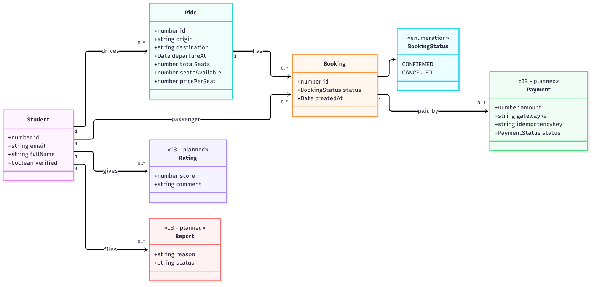
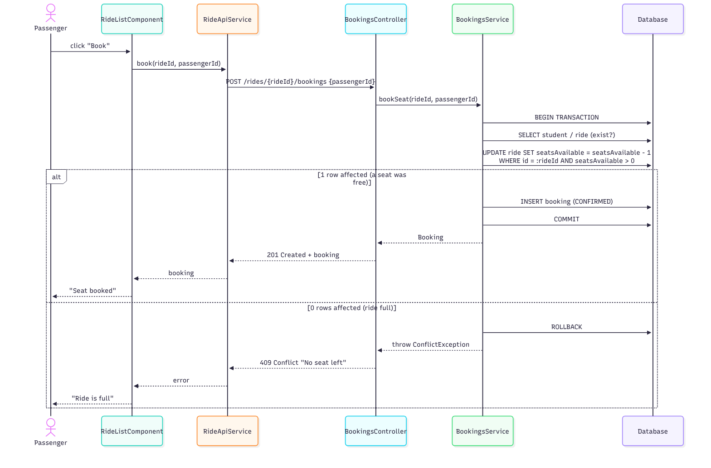

# 4eme-TP-ProcessusUnifies

## Campus Carpooling:

*Covoiturage universitaire: Processus Unifié (UP)*

---

## 1. Vision

- **Problem:** Students commute to campus in cars that run half empty, while others pay for expensive or unreliable transport. Coordination happens in chaotic Facebook or WhatsApp groups with no trust and no guarantees.
- **Users:** Students acting as drivers or passengers, and a university administrator who moderates.
- **Solution:** A platform where verified students publish rides, search for matching routes and schedules, book a seat, and split the cost.
- **Value:** Lower transport costs, fewer cars on the road, and more trust, since only verified university members can join.
- **Scope:** One university, one-off and recurring rides, seat booking with online cost-sharing.

### Actors

| Actor | Type | Role |
|---|---|---|
| **Passenger** | Primary | Searches for rides, books seats, pays |
| **Driver** | Primary | Publishes rides, receives payment |
| **Student** | Generalization | Parent of Passenger and Driver (registration, profile) |
| **Administrator** | Primary | Moderates reports and accounts |
| **Payment gateway** | Secondary (called by the system) | Processes payments and refunds |
| **Notification service** | Secondary (called by the system) | Sends email, SMS or push messages |

---

## 2. Use Cases

| ID | Use case | Technical risk |
|---|---|---|
| UC1 | Register and verify student status (university email) | Medium |
| UC2 | Publish a ride (route, time, seats, price) | Low |
| UC3 | Search for and book a seat | **High:** two passengers booking the last seat |
| UC4 | Pay and share the cost (with refund on cancellation) | **High:** external gateway, double charges, refunds |
| UC5 | Receive notifications (booking confirmed, ride cancelled, reminder) | **Medium-high:** asynchronous delivery, retries |
| UC6 | Rate users and moderate reports (admin) | Low |

Six use cases, three of them carrying technical risk.

---

## 3. Prioritization

Each use case is scored from 1 to 5 on three criteria:

- **Business value:** does the system make sense without it?
- **Risk:** technical or functional uncertainty.
- **Architecture impact:** does it force structural choices (database, locking, external APIs)?

| UC | Business value | Risk | Architecture impact | Total | Rank |
|---|---|---|---|---|---|
| UC3 Book a seat | 5 | 5 | 5 | **15** | 1 |
| UC4 Pay | 4 | 5 | 4 | **13** | 2 |
| UC2 Publish a ride | 5 | 2 | 4 | **11** | 3 |
| UC1 Register / verify | 4 | 3 | 4 | **11** | 3 |
| UC5 Notifications | 3 | 4 | 4 | **11** | 3 |
| UC6 Rate / moderate | 2 | 1 | 2 | **5** | 6 |

### Justification

- **UC3** is the heart of the product and forces the key architectural choices: transactions, locking, and how seats are modeled.
- **UC4** brings in an external dependency and money, so errors are costly.
- **UC2, UC1 and UC5** are tied. UC2 and UC1 are prerequisites for UC3 (no rides and no identity means nothing to book), so minimal versions are built early.
- **UC6** is useful but the system works without it.

**Treat first:** UC3 and UC4, plus minimal versions of UC1 and UC2 as enablers.

---

## 4. Planning: 3 Iterations and the 4 UP Phases
 
Each iteration groups use cases and runs through the whole lifecycle (Inception, Elaboration, Construction, Transition). The work on its use cases gets deeper from one phase to the next.
 
### 4.1 Grouping the 6 use cases into 3 iterations
 
| Iteration | Use cases (score from section 3) | Total | Why grouped this way |
|---|---|---|---|
| **I1: Core booking chain** | **UC3** (15), UC1 (11), UC2 (11) | 37 | UC3 is rank 1. UC1 and UC2 are its prerequisites: with no identity and no ride, there is nothing to book. |
| **I2: External integrations** | **UC4** (13), UC5 (11) | 24 | UC4 is rank 2. Both UC4 and UC5 depend on external services and are triggered by a booking. |
| **I3: Trust and moderation** | UC6 (5) | 5 | Lowest rank and lowest risk, so it comes last. |
 
### 4.2 Iterations over the phases
 
| Iteration | **Inception** (week 1) | **Elaboration** (weeks 2-4) | **Construction** (weeks 5-8) | **Transition** (week 9) |
|---|---|---|---|---|
| **I1: UC3, UC1, UC2** | Identify the 3 UCs, write the main scenarios, note the overbooking risk. | Architecture (database, API, authentication). UC1 minimal (university-email signup). UC2 basic. **UC3 with atomic seat reservation**, tested with concurrent requests. | Complete UC1 (verification, profile), UC2 (recurring rides) and UC3 (search filters, cancellation). Integration tests. | User tests with real students, bug fixes, deployment. |
| **I2: UC4, UC5** | Identify the 2 UCs, the gateway dependency, the double-charge and notification-delivery risks. | **UC4 prototype** in the gateway's test mode, payment tied to booking status. UC5 approach chosen (message queue) with a minimal "booking confirmed" notification. | Complete UC4 (confirmation, failure handling, idempotency, **refund on cancellation**). Complete UC5 (**queue with retries**, fallback channel, all notification types). | Test payment and notification flows with real students, configure the production gateway. |
| **I3: UC6** | Identify UC6 and the rating and report rules. | Design only: rating and report data in the data model. Nothing built, since the risk is low. | Implement UC6 (ratings, report handling, admin moderation). | User tests, documentation, admin training. |
| **Milestone** | **LCO:** scope and vision validated | **LCA:** architecture stable, top 2 risks (UC3, UC4) retired | **IOC:** beta, all core UCs working | **PD:** final release |
 
### How to read this
 
- **By importance:** the highest-ranked UCs (UC3, UC4) are in I1 and I2, and both are built first in Elaboration, while UC6 is delayed to Construction.
- **By time:** reading a column gives the team's work in a phase, and reading a row shows one iteration maturing from analysis to delivery.
- **Risk:** overbooking and payment are tackled in Elaboration, so a problem shows up around week 4, not week 9.
---
### 4.3 Phase milestones

Each phase ends with a UP milestone. It is reached only when every iteration has met its own milestone for that phase (see 4.4).

| Phase | Weeks | Milestone | Due | Exit criteria |
|---|---|---|---|---|
| **Inception** | 1 | **LCO**: Lifecycle Objectives | End of week 1 | Vision approved. 6 UCs identified and prioritized. Main risks listed (overbooking, double charge, notification delivery). Iteration plan accepted. |
| **Elaboration** | 2-4 | **LCA**: Lifecycle Architecture | End of week 4 | Executable architecture baseline (database, API, authentication). Top 2 risks retired: UC3 overbooking and UC4 payment. Data model stable, including UC6. |
| **Construction** | 5-8 | **IOC**: Initial Operational Capability | End of week 8 | All 6 UCs implemented. Integration tests passing. Beta deployable for real users. |
| **Transition** | 9 | **PD**: Product Release | End of week 9 | User acceptance done. Production gateway configured. Documentation delivered and admin trained. |

### 4.4 Iteration × phase milestones

Each cell is a milestone named **M{iteration}.{phase}**, with a check the team can verify. A phase milestone (4.3) is met when all the milestones in its column are met.

| Iteration | **Inception** (end of week 1) | **Elaboration** (end of week 4) | **Construction** (end of week 8) | **Transition** (end of week 9) |
|---|---|---|---|---|
| **I1: UC3, UC1, UC2** | **M1.1:** Main scenarios of UC1, UC2 and UC3 written and validated. Overbooking risk recorded. | **M1.2:** Architecture baseline running. Concurrent booking test passes: N parallel requests for the last seat give exactly 1 booking. **Risk 1 retired.** | **M1.3:** UC1 (verification, profile), UC2 (recurring rides) and UC3 (filters, cancellation) complete. Integration tests green. | **M1.4:** Tested by real students. Blocking bugs fixed. Booking chain deployed. |
| **I2: UC4, UC5** | **M2.1:** UC4 and UC5 scenarios written. Gateway chosen. Double-charge and delivery risks recorded. | **M2.2:** Payment works in the gateway's test mode and is linked to booking status. A "booking confirmed" notification is delivered through the queue. **Risk 2 retired.** | **M2.3:** Payment is idempotent (a replayed request charges once). Refund on cancellation works. Queue retries and fallback channel work. All notification types are sent. | **M2.4:** End-to-end payment and notification flows tested with students. Production gateway configured. |
| **I3: UC6** | **M3.1:** Rating and report rules defined. | **M3.2:** Rating and report entities added to the data model (design only). | **M3.3:** Ratings, report handling and admin moderation implemented and tested. | **M3.4:** User tests done. Documentation written. Admin trained. |
| **Phase milestone** | **LCO** = M1.1 + M2.1 + M3.1 | **LCA** = M1.2 + M2.2 + M3.2 | **IOC** = M1.3 + M2.3 + M3.3 | **PD** = M1.4 + M2.4 + M3.4 |

---
# Elaboration: Baseline Architecture (I1, milestone M1.2)

Goal of this baseline: **one end-to-end route that runs** for the riskiest use case,
**UC3 – Book a seat**, going through every layer (UI → controller → service → data access → database),
with **an automated test that passes in CI**.

The diagrams are written in Mermaid (`docs/diagrams/*.mmd`) and exported as PNG so they display in any Markdown viewer.
The code in `backend/` and `frontend/` is derived directly from them:
every box and every class name here exists in the code with the same name.

---

## 1. Logical architecture (layers)

*Source: [`diagrams/1-architecture-layers.mmd`](diagrams/1-architecture-layers.mmd)*

| Layer | Responsibility | Rule |
|---|---|---|
| Presentation (controllers) | HTTP: routes, validation, status codes | No business logic |
| Business (services) | Use-case rules: "a seat can be booked only if one is left" | No HTTP, no SQL strings outside the transaction |
| Data access (repositories / entities) | Persistence through TypeORM | Only layer that talks to the database |

---

## 2. Domain model (class diagram)

Implemented in this baseline: `Student`, `Ride`, `Booking`.
Designed now, built later (I2 and I3, per the plan): `Payment`, `Rating`, `Report`.

*Source: [`diagrams/2-domain-class-diagram.mmd`](diagrams/2-domain-class-diagram.mmd)*

**Invariant (the UC3 risk):** `0 <= Ride.seatsAvailable <= Ride.totalSeats`, and the number of
`CONFIRMED` bookings of a ride is `totalSeats - seatsAvailable`. A passenger cannot book the same ride twice
(unique constraint on `(rideId, passengerId)`).

---

## 3. UC3 – Book a seat (sequence diagram)

The overbooking risk is removed by a **conditional, atomic update**: the database decrements the counter
only if a seat is still free, and tells us how many rows it changed. Two passengers racing for the last
seat cannot both get `1 row affected`.

*Source: [`diagrams/3-uc3-book-seat-sequence.mmd`](diagrams/3-uc3-book-seat-sequence.mmd)*

Other error cases: unknown ride or student → `404`; same passenger books twice → `409`.

---

## 4. Traceability: diagram → code

| Diagram element | File |
|---|---|
| `RidesController`, `BookingsController` | `backend/src/rides/rides.controller.ts`, `backend/src/bookings/bookings.controller.ts` |
| `RidesService`, `BookingsService.bookSeat()` | `backend/src/rides/rides.service.ts`, `backend/src/bookings/bookings.service.ts` |
| `Student`, `Ride`, `Booking`, `BookingStatus` | `backend/src/**/*.entity.ts` |
| Atomic update (sequence diagram) | `BookingsService.bookSeat()` |
| `RideListComponent`, `RideApiService` | `frontend/src/app/ride-list/`, `frontend/src/app/ride-api.service.ts` |
| Test of the risk (M1.2 criterion) | `backend/test/bookings.e2e-spec.ts` |
| CI | `.github/workflows/ci.yml` |
