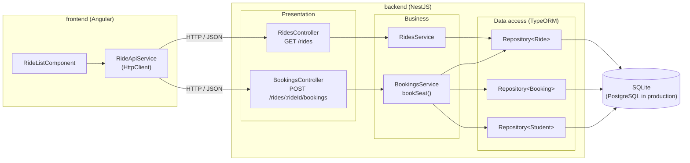
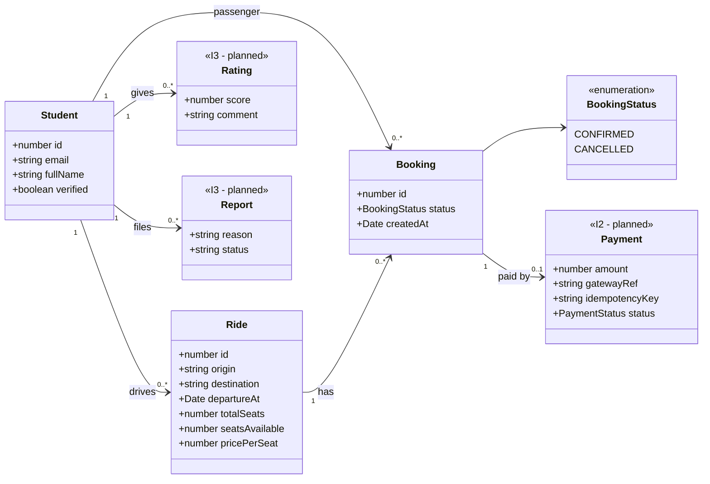
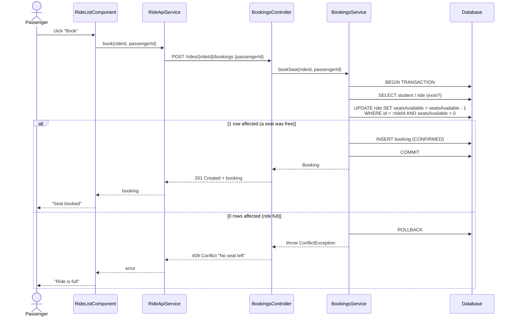

# Elaboration: Baseline Architecture (I1, milestone M1.2)

Goal of this baseline: **one end-to-end route that runs** for the riskiest use case,
**UC3 – Book a seat**, going through every layer (UI → controller → service → data access → database),
with **an automated test that passes in CI**.

The code in `backend/` and `frontend/` is derived directly from the three diagrams below:
every box and every class name here exists in the code with the same name.

---

## 1. Logical architecture (layers)

| Layer | Responsibility | Rule |
|---|---|---|
| Presentation (controllers) | HTTP: routes, validation, status codes | No business logic |
| Business (services) | Use-case rules: "a seat can be booked only if one is left" | No HTTP, no SQL strings outside the transaction |
| Data access (repositories / entities) | Persistence through TypeORM | Only layer that talks to the database |

---

## 2. Domain model (class diagram)

Implemented in this baseline: `Student`, `Ride`, `Booking`.
Designed now, built later (I2 and I3, per the plan): `Payment`, `Rating`, `Report`.

**Invariant (the UC3 risk):** `0 <= Ride.seatsAvailable <= Ride.totalSeats`, and the number of
`CONFIRMED` bookings of a ride is `totalSeats - seatsAvailable`. A passenger cannot book the same ride twice
(unique constraint on `(rideId, passengerId)`).

---

## 3. UC3 – Book a seat (sequence diagram)

The overbooking risk is removed by a **conditional, atomic update**: the database decrements the counter
only if a seat is still free, and tells us how many rows it changed. Two passengers racing for the last
seat cannot both get `1 row affected`.

Other error cases: unknown ride or student → `404`; same passenger books twice → `409`.

---

## 4. Traceability: diagram → code

| Diagram element | File |
|---|---|
| `RidesController`, `BookingsController` | `backend/src/rides/rides.controller.ts`, `backend/src/bookings/bookings.controller.ts` |
| `RidesService`, `BookingsService.bookSeat()` | `backend/src/rides/rides.service.ts`, `backend/src/bookings/bookings.service.ts` |
| `Student`, `Ride`, `Booking`, `BookingStatus` | `backend/src/**/*.entity.ts` |
| Atomic update (sequence diagram) | `BookingsService.bookSeat()` |
| `RideListComponent`, `RideApiService` | `frontend/src/app/ride-list/`, `frontend/src/app/ride-api.service.ts` |
| Test of the risk (M1.2 criterion) | `backend/test/bookings.e2e-spec.ts` |
| CI | `.github/workflows/ci.yml` |
